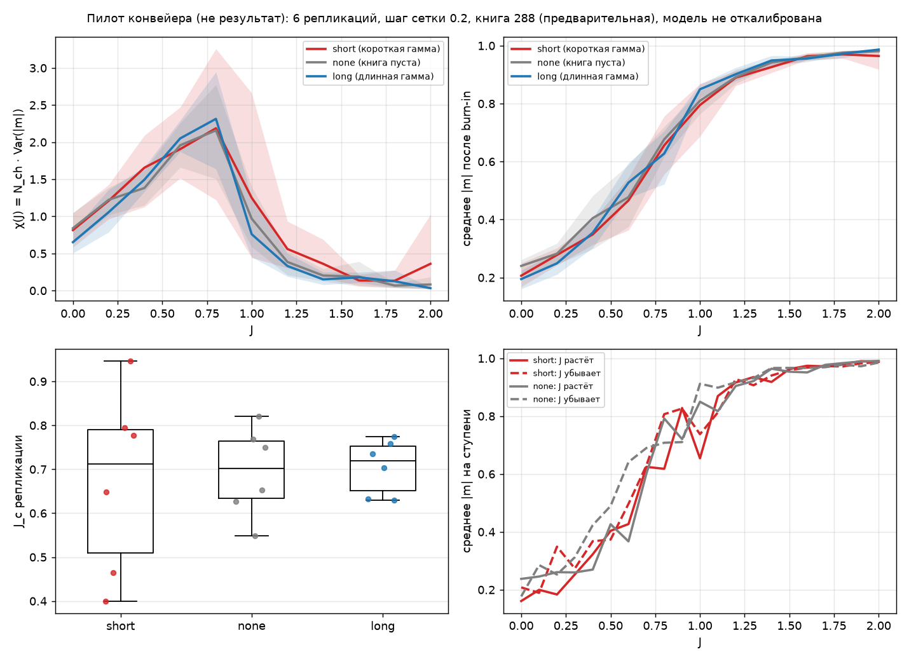

# Пилот конвейера (задача C-8, контрольная точка M4)

Создано скриптом `experiments/pilot.py` 26.11.2026. Код: 2f651e6. Машина: arm64, 18 ядер, Python 3.13.15.

**Это не результат.** Модель ещё не откалибрована, размер книги предварительный (n₀ = 288), репликаций мало, сетка грубая, сиды из отладочного потока (не совпадают ни с одним прогоном полного эксперимента). Цель — проверить, что конвейер проходит целиком, и узнать, сколько займёт полный счёт. В отчёт эти числа не идут.

## Что прогнано

1. Развёртка по J: 3 конфигурации × 11 точек сетки (шаг 0.2) × 6 репликаций, 1500 шагов, burn-in 500; запись сводок с дозапуском.
2. Гистерезис по протоколу prereg: 3 конфигурации × 3 репликации, 21 ступень вверх и 21 вниз по 200 шагов, burn-in 500.
3. Проба размеров книги: short и long, n ∈ {0.25; 0.5; 1; 2; 4}·n₀, J ∈ {0.5; 1.0; 1.5}, 2 репликации.
4. Анализ: χ(J) и J_c (парабола по трём точкам, флаг края), правила замены прерванных прогонов, J_fix и J_ref по правилам prereg, три теста с размерами эффекта, бутстрэп-ДИ и поправкой Холма.
5. Рисунки: F4_chi.png, F5_m.png, F6_jc.png, F7_sigma.png, F8_hysteresis.png в `results/pilot/`, обзор — `docs/pilot.png`.

## Время

| этап | прогонов | с на прогон (1 процесс) | всего, с |
|---|---|---|---|
| развёртка по J | 198 | 2.59 | 32 |
| гистерезис (8900 шагов) | 9 | 23.4 | 27 |
| проба размеров книги | 60 | 2.92 | 13 |
| анализ: J_c, тесты (10 000 перестановок и бутстрэп-повторов) | — | — | 1 |

| конфигурация | с на прогон 1500 шагов |
|---|---|
| long | 2.88 |
| none | 2.57 |
| short | 2.33 |

Параллельное ускорение на развёртке: 16.2× при 18 процессах (сумма времени прогонов / время по часам).

## План полного счёта

Основной эксперимент: 3 × 21 × 30 = 1890 прогонов (В1 берёт σ из тех же прогонов при J_fix). Чувствительность: ещё 4 размера книги × 1890 (базовый размер совпадает с основным). Гистерезис: 3 × 30 длинных прогонов. Запас 5% на замены прерванных прогонов.

| эксперимент | прогонов | ЦП, ч | на этой машине, ч (18 процессов) |
|---|---|---|---|
| основной (Г и В1) | 1890 | 1.43 | 0.09 |
| чувствительность, 4 доп. размера | 7560 | 6.21 | 0.38 |
| гистерезис (В2) | 90 | 0.61 | 0.04 |

Итого на этой машине около 0.5 ч. Порядок: основной эксперимент и гистерезис сразу после `config-v1`, чувствительность следом; при нехватке времени `--configs` делит счёт между ноутбуками (сиды детерминированы, CSV сливаются).

## Прерванные прогоны

| config | size_index | runs | failed_runs | replaced_reps | used_reps | edge_peaks |
|---|---|---|---|---|---|---|
| long | 2 | 66 | 0 | 0 | 6 | 0 |
| none | 2 | 66 | 0 | 0 | 6 | 0 |
| short | 2 | 66 | 0 | 0 | 6 | 0 |

Проба размеров книги (выживает ли рынок при большой книге дилеров):

| config | size_index | книга | прогонов | прервано | время_с | доля_дилеров | гамма_книги |
|---|---|---|---|---|---|---|---|
| long | 0 | 72 | 6 | 0 | 3.12 | 0.0415 | 27 |
| long | 1 | 144 | 6 | 0 | 3.24 | 0.0816 | 59.3 |
| long | 2 | 288 | 6 | 0 | 2.99 | 0.145 | 119 |
| long | 3 | 576 | 6 | 0 | 3.04 | 0.226 | 223 |
| long | 4 | 1.15e+03 | 6 | 0 | 2.78 | 0.392 | 480 |
| short | 0 | 72 | 6 | 0 | 2.8 | 0.0399 | -28.7 |
| short | 1 | 144 | 6 | 0 | 2.75 | 0.0777 | -50.8 |
| short | 2 | 288 | 6 | 0 | 2.68 | 0.152 | -112 |
| short | 3 | 576 | 6 | 0 | 2.96 | 0.266 | -220 |
| short | 4 | 1.15e+03 | 6 | 0 | 2.81 | 0.441 | -323 |

## Конвейер на пилотных данных

J_fix по правилу prereg (наименьшая точка сетки, где среднее |m| без дилеров ≥ 0.8): 1; J_ref (наибольшая точка, где ≤ 0.3): 0.2. Посчитано на неоткалиброванной модели и грубой сетке, окончательные значения — после калибровки.

**Г. критическая связь J_c = argmax_J χ(J)**

- H₀: распределения J_c в трёх конфигурациях одинаковы
- H₁: J_c(short) ≤ J_c(none) ≤ J_c(long), хотя бы одно неравенство строгое
- Тест: Джонкхира–Терпстры, односторонний; α = 0.05
- Наблюдений (репликаций): short: 6, none: 6, long: 6
- Статистика: J = 53
- p-значение: 0.554 (перестановочное, 10000 перестановок)
- p с поправкой Холма: 1
- z (нормальное приближение): -0.08085
- p (нормальное приближение): 0.5322
- med J_c(none) − med J_c(short): -0.01063, ДИ 95% [-0.1964; 0.2954]
- med J_c(long) − med J_c(none): 0.01777, ДИ 95% [-0.1265; 0.1352]
- τ Кендалла между порядком конфигурации (short = 1, none = 2, long = 3) и J_c: -0.01556, ДИ 95% [-0.446; 0.433]
- Вывод: H₀ не отвергается: p с поправкой Холма = 1 > α = 0.05. По этим данным нельзя утверждать, что J_c(short) < J_c(none) < J_c(long).

**В1. σ лог-доходностей при J = J_fix**

- H₀: распределения σ в трёх конфигурациях одинаковы
- H₁: σ(long) ≤ σ(none) ≤ σ(short), хотя бы одно неравенство строгое
- Тест: Джонкхира–Терпстры, односторонний; α = 0.05
- Наблюдений (репликаций): short: 6, none: 6, long: 6
- Статистика: J = 56
- p-значение: 0.4461 (перестановочное, 10000 перестановок)
- p с поправкой Холма: 1
- z (нормальное приближение): 0.1617
- p (нормальное приближение): 0.4358
- med σ(short) / med σ(none): 0.9516, ДИ 95% [0.7453; 1.298]
- med σ(none) / med σ(long): 1.018, ДИ 95% [0.806; 1.341]
- Вывод: H₀ не отвергается: p с поправкой Холма = 1 > α = 0.05. По этим данным нельзя утверждать, что σ(long) < σ(none) < σ(short).

**В2. площадь петли гистерезиса A**

- H₀: распределения A в конфигурациях short и none одинаковы
- H₁: A(short) стохастически больше A(none)
- Тест: Манна–Уитни, односторонний; α = 0.05
- Наблюдений (репликаций): short: 3, none: 3
- Статистика: U = 2
- p-значение: 0.9 (точное)
- p с поправкой Холма: 1
- P(A_short > A_none) = U/(n₁n₂): 0.2222, ДИ 95% [0; 0.6667]
- med A(short) − med A(none): -0.02712, ДИ 95% [-0.1173; 0.04773]
- Вывод: H₀ не отвергается: p с поправкой Холма = 1 > α = 0.05. По этим данным нельзя утверждать, что A(short) стохастически больше A(none).

При такой малой выборке выводы тестов ничего не значат: здесь проверяется только, что каждый шаг конвейера работает и выдаёт отчёт в нужной форме.

